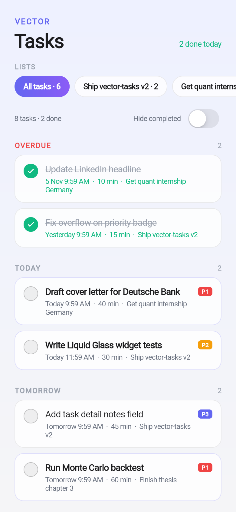
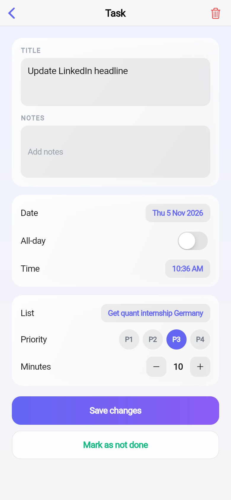

# Vector Tasks

**Type one end goal. Get back a plan you can actually start.**

Part of the **VECTOR Suite** — three apps, one private database.

---

## The Problem

> "I am not productive. I have too many to‑do lists, and I don't know
> which one to start, so I start nothing."

The issue is not a missing to‑do list. A list of 20 undifferentiated items *causes* the paralysis. This app flips the model: **You never write a task.**

- **Input**: an outcome (e.g. *"get a quant internship in Germany"*, *"finish thesis chapter 3"*).
- **Output**: a dependency‑ordered plan where the **first step is always startable in under 30 minutes**.

## How It Works

The app shows **multiple lists side by side**, but each list contains tasks grouped by date (Overdue, Today, Tomorrow, Later, No date). A **list selector chip row** at the top lets you switch between "All tasks" and individual goals. Each task row shows its priority badge (P1–P4), due date, duration, and whether it is startable right now (highlighted in accent). Tapping a row opens a detail page where you can edit title, date, time, all‑day, notes, priority, minutes, and the list it belongs to.

A **quick‑add card** at the bottom lets you create tasks with title, due date, priority, and notes. New lists can be created with the "Add list" button.

The app runs in **viewer mode** by default (`VECTOR_READ_ONLY=true`): editing surfaces are hidden so only one writer (Hermes) changes the data. Flip it with `--dart-define=VECTOR_READ_ONLY=false` for an editable build.

## Home‑Screen Widget

`NextActionWidget` (Android) shows the single next action without opening the app. It reads the API directly on a background thread, keeping it current.

## Screenshots

<!-- Generated by CI -->
| Screen | Screenshot |
|--------|------------|
| Home |  |
| Goals |  |
| Task Detail |  |

## Screens

| Screen | Description |
|--------|-------------|
| **Home** | List selector chips, task rows grouped by date bucket, quick‑add card (editable mode only), new‑list card. |
| **Task Detail** | Edit title, notes, date, time, all‑day, list, priority, minutes. Mark done / delete with confirmation. |

## Architecture

```
Flutter app  ──HTTP──▶  VECTOR Suite API  ──▶  private database
  (this repo)             (decompose + store)
```

The LLM key lives server‑side only — shipping it in an APK would make it extractable with `unzip` + `strings`. No app ever calls a model directly.

## Build

```bash
flutter pub get
flutter test
flutter build apk --release --target-platform android-arm64 --split-per-abi
```

Point at your own server:

```bash
flutter build apk --dart-define=API_BASE=https://your-host
```

CI builds the APK on every push, injects `API_BASE` from the repo's variable, so the endpoint can change without touching code.

## Widget Endpoint

The widget reads `vector_api_base` from `android/app/src/main/res/values/strings.xml`. CI rewrites that value from the same `API_BASE` variable, so the widget and the app cannot point at different servers.

## The VECTOR Suite

| App | Question it answers |
|-----|---------------------|
| **Vector Tasks** (this) | What is the one thing to start right now? |
| [Vector Calendar](https://github.com/JoshRiang/vector-calendar) | How is today going? |
| [Vector Finance](https://github.com/JoshRiang/vector-finance) | How much runway is left? |

All three share one private database. A task created here appears on the calendar and informs the day's cost.

## Privacy

Every table is row‑level‑security gated on the authenticated user. The backend runs on the owner's own server.

## Licence

MIT